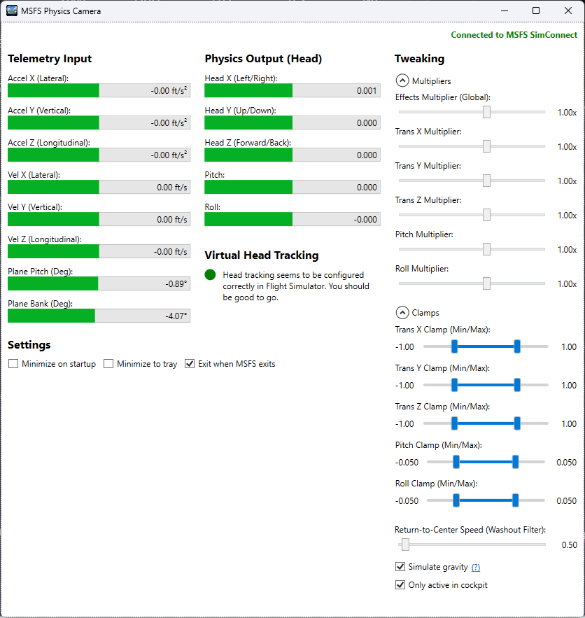

# MSFS Physics Camera

> **This is a fork.** What it adds (look into turns, pausing on foot and at a standstill, a diagnostic log) and how it runs on Linux/Proton: [FORK.md](FORK.md).


A standalone application for Microsoft Flight Simulator 2020/2024 that adds realistic, physics-based head movements (head shake, G-force effects) to the virtual cockpit. It reads aircraft telemetry via SimConnect and injects camera movements using the FreeTrack protocol.

## Features

- **Physics-Based Movement**: Uses a spring-mass-damper physics engine to simulate realistic head movements based on aircraft acceleration and velocity.
- **Customizable Effects**: Adjust the intensity of lateral, vertical, longitudinal, pitch, and roll movements in real-time via the UI, and many other settings.
- **Seamless Integration**: Connects to MSFS via SimConnect and injects data via FreeTrack.
- **Auto-Start & Auto-Exit**: Includes scripts to automatically start with MSFS, and a setting to automatically exit when MSFS closes.

## Showcase



https://github.com/user-attachments/assets/754c5b30-4dcb-49b1-9095-6a5220380bea

https://github.com/user-attachments/assets/f35fa594-357c-4c8a-a619-67fbac6674d8

https://github.com/user-attachments/assets/abc0d6e2-2e89-48db-8f8d-b41ec855b2ba

## Compatibility

Verified to work on:
- Microsoft Flight Simulator 2020
- Microsoft Flight Simulator 2024

## Installation

1. Download the latest release.
2. Extract the files to your MSFS Community folder (or any other folder of your choice).
3. Run `AutoStart-Install.bat` to register the application to start automatically when MSFS launches.
   - *To uninstall the auto-start behavior, run `AutoStart-Uninstall.bat`.*
4. Alternatively, you can run `MsfsPhysicsCamera.exe` manually before or during your flight.
5. You'll likely want to disable the built-in camera shake 

*Note: TrackIR/FreeTrack is automatically enabled on first run if found to be unconfigured using the included `NPClient64.dll`.*

## FAQ

**I do see telemetry and output in the app while moving my airplane ingame, but my camera does not seem to react. Even at x5 multiplier. What gives?**

If you haven't already, you might need to restart MSFS. When you launch the app for the first time, it enables the "TrackIR" controller. A restart of MSFS 2024 is needed to make it appear.

**Can I use this app together with my head tracker (Tobii / TrackIR / Opentrack)?**

Unfortunately, no. Both your head tracker and this tool will send camera offsets to Flight Simulator. Flight Simulator will pick one over the other, or just alternate the inputs, which will manifest into weird behavior.

**It feels like the camera is drifting at high speed or in turns**

While ascending/descending the gravity weighs on your head while you're pitched up/down. Similarly in turns. Since v1.5 there are two settings that remedy this, of which one is enabled by default.
* The "Return-to-center speed" (defaulting to 0.5) option will make the camera return to center slowly over time.
* Disabling "Simulate gravity" prevents the fake gravity calculation based on pitch/roll angles.

## Development

### Prerequisites

- [.NET 10.0 SDK](https://dotnet.microsoft.com/download/dotnet/10.0)
- Microsoft Flight Simulator 2024 SDK (required for `SimConnect.dll`)

### Setup

```bash
# Clone the repository
git clone https://github.com/martijns/martijns-msfs2024-physics-camera.git
cd martijns-msfs2024-physics-camera

# Build the project
dotnet build
```

*Note: The project expects `SimConnect.dll` to be located at `c:\MSFS 2024 SDK\SimConnect SDK\lib\SimConnect.dll`.*

### Debugging

You can run and debug the application directly from Visual Studio or VS Code. The application will attempt to connect to SimConnect and the FreeTrack shared memory automatically.

## License

MIT License - see LICENSE file for details.
